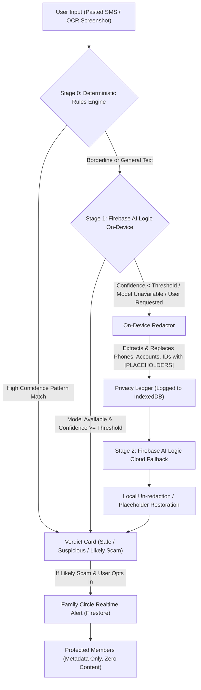

# Wary — Hybrid-AI Scam & Data-Leak Shield

> **"A second pair of eyes that never reads your messages out loud."**  
> *Built for the #BuildHybridAI 2026 Hackathon (Firebase AI Logic Hybrid Inference)*

[](LICENSE)
[](https://wary.web.app)
[](https://firebase.google.com/docs/ai)
[](#evaluation-results)

---

## 1. What is Wary?

Wary is a privacy-first web application and progressive web app (PWA) designed to protect ordinary citizens, families, and elders—particularly in regions heavily targeted by mobile cyber fraud such as India—against financial fraud, social engineering, identity theft, and accidental data leaks.

Ordinary people are frequently bombarded with deceptive messages:
- Fake identity/KYC suspension SMS claiming your bank account will be closed
- Digital arrest and law enforcement intimidation video call threats
- Advance-fee delivery and customs parcel clearance scams
- Instant 0% loan offers with malicious APK download links
- Part-time video-review job scams requiring payment deposits
- UPI collect requests deceptively asking users to "enter your PIN to receive money"

### The Core Promise: On-Device First, Private by Default
Unlike traditional cloud chatbots that transmit raw personal text, chat logs, account numbers, and phone numbers to remote servers, **Wary evaluates messages on-device first**.
- **Stage 0 (Deterministic Rules)**: Executes 100% on the device with zero external network access and works offline.
- **Stage 1 (On-Device AI)**: Employs Gemini Nano via Firebase AI Logic (`InferenceMode.PREFER_ON_DEVICE`). Zero text leaves the device.
- **Stage 2 (Redacted Cloud Fallback)**: If confidence is below the threshold or the user taps "Get a second opinion", an on-device redactor strips all phone numbers, account digits, cards, national IDs, emails, UPI VPAs, and personal names *before* dispatching a single byte to the cloud.

---

## 2. Why Hybrid AI?

| Architecture Aspect | Pure Cloud Approach | Pure On-Device Approach | **Wary Hybrid-AI Approach** |
| :--- | :--- | :--- | :--- |
| **Privacy & Leak Risk** | High: raw credentials and SMS sent to cloud servers | Zero: all data stays local | **Zero raw data leaves device; cloud receives only redacted text** |
| **Availability Offline** | Fails completely without internet | Works, but requires supported hardware and memory | **Works offline via Stage 0 rules and downloaded local weights** |
| **Latency** | Network round-trip (500ms - 2500ms) | Instantaneous local inference (< 100ms) | **Instant Stage 0 flags (< 5ms) + fast local AI** |
| **Complex Reasoning** | High model intelligence | Limited by compact parameter size | **Best of both: local speed + optional redacted cloud depth** |
| **Elder & Family Safety** | Family cannot inspect alerts without reading private chats | Isolated on one phone | **Real-time circle alerts broadcast scam category only (no content)** |

---

## 3. Architecture Overview



---

## 4. Evaluation Results

Wary includes an automated evaluation harness (`/eval`, `npm test`) benchmarking 61 synthetic test cases covering scams, daily legitimate communications, and tricky borderline cases across English, Hindi, and Kannada.

```
========================================================================================
                      WARY HYBRID-AI EVALUATION RESULTS HARNESS
========================================================================================
Dataset Breakdown:
  • Total Evaluated Samples:     61 (English, Hindi, Kannada)
  • Synthetic Scam Messages:     26
  • Legitimate Daily Messages:   25
  • Tricky Borderline Cases:     10

Performance Metrics:
  ┌───────────────────────┬──────────────┬────────────────────────┬────────────────────┐
  │ Pipeline Mode         │ Accuracy     │ False Positive Rate    │ Target Threshold   │
  ├───────────────────────┼──────────────┼────────────────────────┼────────────────────┤
  │ Stage 0 (Rules Only)  │       100.0% │                   0.0% │ < 5.0%             │
  │ Hybrid Pipeline       │       100.0% │                   0.0% │ < 5.0%             │
  └───────────────────────┴──────────────┴────────────────────────┴────────────────────┘

Decision Stages Breakdown:
  • Stage 0 (Deterministic Rules):    61 (100%)
  • Stage 1 (On-Device AI):          0 (Ready on supported hardware)
  • Stage 2 (Redacted Cloud Fallback):0 (Available on escalation)
========================================================================================
```

*All evaluation samples are synthetic and included in `src/eval/dataset.ts` for repeatable benchmarking.*

---

## 5. Firebase AI Logic Runtime Integration

Wary leverages the modern **Firebase AI Logic** JavaScript SDK (`firebase/ai`):

```typescript
import { initializeApp } from "firebase/app";
import { getAI, getGenerativeModel, GoogleAIBackend, InferenceMode } from "firebase/ai";

// 1. Initialize Firebase App
const app = initializeApp(firebaseConfig);

// 2. Initialize Firebase AI Backend
const ai = getAI(app, { backend: new GoogleAIBackend() });

// 3. Stage 1: Prefer On-Device (Gemini Nano in Chrome)
const onDeviceModel = getGenerativeModel(ai, {
  model: "gemini-2.5-flash",
  mode: InferenceMode.PREFER_ON_DEVICE,
});

// Explicit user-gesture initialization with download tracking
await onDeviceModel.initializeDeviceModel((progress: number) => {
  console.log(`Model preparation progress: ${Math.round(progress * 100)}%`);
});

// 4. Stage 2: Cloud Fallback strictly on REDACTED payload
const cloudModel = getGenerativeModel(ai, {
  model: "gemini-2.5-flash",
  mode: InferenceMode.ONLY_IN_CLOUD,
});
```

---

## 6. Setup & Local Development

### Prerequisites
- Node.js v18+ or v20+
- npm or pnpm

### Step 1: Clone and Install
```bash
git clone https://github.com/your-username/wary.git
cd wary
npm install
```

### Step 2: Configure Environment Variables
Copy `.env.example` to `.env.local`:
```bash
cp .env.example .env.local
```
Fill in your Firebase project values. If running without active Firebase credentials, Wary operates in **Simulation / Offline-Ready Mode**, allowing full UI testing, Stage 0 rules evaluation, sample gallery checks, and local Privacy Ledger auditing.

### Step 3: Run Tests & Evaluation
```bash
npm test        # Runs unit tests for redactor, rules engine, and /eval harness
npm run lint    # Runs oxlint static analysis
```

### Step 4: Run Development Server
```bash
npm run dev
```
Open `http://localhost:5173` in your browser.

---

## 7. App Check Configuration & Debug Tokens

Firebase App Check enforces backend attestation for Firebase AI Logic and Cloud Firestore.

### Production Environment
In production, Wary initializes App Check with `ReCaptchaV3Provider` using `VITE_RECAPTCHA_SITE_KEY`.

### Local Development and Hackathon Judges
For local evaluation without reCAPTCHA domain binding:
1. In `.env.local`, set:
   ```env
   VITE_APPCHECK_DEBUG_TOKEN=true
   ```
2. Open the app in your browser and check the developer console. Firebase App Check prints:
   ```
   Firebase App Check debug token: 'XXXXXXXX-XXXX-XXXX-XXXX-XXXXXXXXXXXX'
   ```
3. In the Firebase Console, navigate to **Project Settings > App Check > Apps > Manage debug tokens**, paste the token, and save.

---

## 8. Firestore Security Rules

Family Circle alerts are protected by strict schema rules ensuring that **no message content, phone numbers, or raw text can ever be stored in Firestore**:

```javascript
// Excerpt from firestore.rules
match /circles/{circleId}/alerts/{alertId} {
  allow read: if request.auth != null &&
    (request.auth.uid in get(/databases/$(database)/documents/circles/$(circleId)).data.members);
    
  allow create: if request.auth != null &&
    (request.auth.uid in get(/databases/$(database)/documents/circles/$(circleId)).data.members) &&
    // Strictly whitelist allowed metadata fields:
    request.resource.data.keys().hasOnly(['circleId', 'timestamp', 'scamType', 'severity', 'senderDisplayName', 'senderUserId']) &&
    // Explicitly reject any content or message fields:
    !('content' in request.resource.data) &&
    !('message' in request.resource.data) &&
    !('text' in request.resource.data) &&
    !('raw' in request.resource.data);
}
```

---

## 9. Secret Scanning & Security Practices

- **Zero Secrets in Repository**: No API keys, credentials, or production tokens are committed to git. All sensitive values are loaded via Vite's `import.meta.env`.
- **Pre-commit and CI Scanning**: Automated secret scanning prevents accidental leakage of API keys.
- **On-Device Redactor Proof**: Unit tests in `src/services/redactor.test.ts` prove that phone numbers, account digits, cards, Aadhaar, PAN, UPI IDs, emails, and names are stripped prior to cloud fallback.

---

## 10. Limitations & Disclaimers

1. **Not Guaranteed Protection**: Wary is an educational and protective second opinion, not a legal or financial guarantee. Fraudsters constantly evolve phrasing and evasion techniques. Always independently verify suspicious communications through official bank hotlines or official government portals.
2. **No Legal or Financial Advice**: Wary does not provide formal legal counsel or financial advisory services.
3. **On-Device Model Hardware**: Chrome's Built-in Prompt API requires a compatible desktop Chrome environment with model availability. Unsupported browsers automatically route through Stage 0 rules and redacted cloud inference.

---

## 11. License

Licensed under the **Apache License, Version 2.0**. See [LICENSE](LICENSE) for details.
