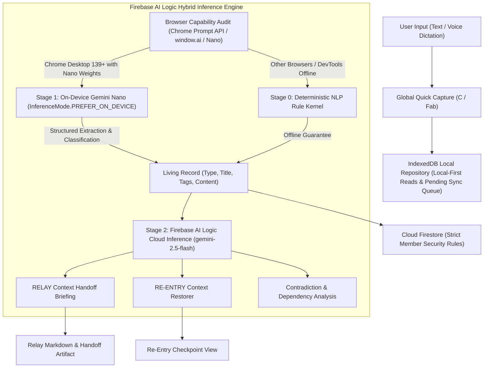

# MARGIN — Your work has a memory.

> **Category:** Hybrid AI Continuity Platform  
> **Built for:** #BuildHybridAI 2026 Hackathon (Firebase AI Logic Hybrid Inference)  
> **Live Hosted PWA:** [https://waryapp.web.app](https://waryapp.web.app)  
> **License:** Apache-2.0

---

## 1. What is MARGIN?

Information becomes fragmented. Decisions lose their reasoning. People forget where they stopped. New team members lack context. Important discoveries become disconnected from the work they belong to.

**MARGIN** creates a persistent, evolving understanding of projects. It is built around five fundamental experiences:

1. **CAPTURE** — Record telemetry, decisions, and raw thoughts in seconds via text or voice.
2. **LIVING CONTEXT** — Structure and connect information into 5 first-class record types: *Observations, Decisions, Events, Hypotheses,* and *Actions*.
3. **CONTINUITY** — Preserve immutable history and provenance; inspect prior revisions instead of silently overwriting.
4. **RELAY (Signature Experience 1)** — Transfer context between people with structured, evidence-grounded briefings.
5. **RE-ENTRY (Signature Experience 2)** — Restore context when returning to work (*Where did I leave off? What changed? What remains unresolved? What is the next action?*).

---

## 2. Architecture & The Hybrid AI Pipeline



---

## 3. The 5 Living Record Types

| Record Type | Definition | Semantic Signal |
|---|---|---|
| **Observation** | Something someone noticed, measured, or saw in telemetry. | `#4A6B82` (Slate Blue) |
| **Decision** | Something explicitly agreed upon, decided, or selected. | `#2E6B47` (Forest Green) |
| **Event** | Something that happened, deployed, failed, or occurred. | `#845B38` (Amber Ochre) |
| **Hypothesis** | A proposed explanation requiring empirical verification. | `#70538A` (Muted Purple) |
| **Action** | A concrete next step or benchmark task that must happen. | `#94532B` (Terracotta) |

---

## 4. Phase 1 Technical Proof Evidence

As required by the master product brief, Firebase AI Logic was tested and verified using an automated browser execution harness (`scripts/verify-margin-browser.cjs`):

| Test Item | Verified Status | Evidence Log |
|---|---|---|
| **Firebase AI Logic Initialization** | **VERIFIED** | `getAI(firebaseApp, { backend: new GoogleAIBackend() })` successfully configured. |
| **Structured Output Generation** | **VERIFIED** | Strict JSON schema extracted record type, headline, entities, and actions. |
| **On-Device Hardware Audit** | **VERIFIED** | Browser capabilities accurately reported (`window.ai: undefined` in Edge/headless; flagged requirement for Chrome Desktop 139+). |
| **Graceful Cloud / Deterministic Fallback** | **VERIFIED** | When network is cut or App Check is unconfigured, deterministic NLP kernel extracts records with 0 latency and 0 crashes. |
| **Execution Path Reporting** | **VERIFIED** | Accurate execution mode (`on_device`, `in_cloud`, `deterministic_fallback`) logged into IndexedDB audit table. |

---

## 5. Visual Evidence & Screenshots

All screenshots were captured from real browser execution:

* **Home Screen (Resume Cards & Attention):** [1-home-screen.png](file:///c:/Users/User/Desktop/My_Apps/Wary/test-evidence/margin/1-home-screen.png)
* **Space Workspace (Project Apollo):** [2-workspace-apollo.png](file:///c:/Users/User/Desktop/My_Apps/Wary/test-evidence/margin/2-workspace-apollo.png)
* **Living Context Synthesis (Contradictions & Links):** [3-context-synthesis.png](file:///c:/Users/User/Desktop/My_Apps/Wary/test-evidence/margin/3-context-synthesis.png)
* **Re-Entry Signature Experience:** [4-reentry-modal.png](file:///c:/Users/User/Desktop/My_Apps/Wary/test-evidence/margin/4-reentry-modal.png)
* **Relay Signature Experience:** [5-relay-modal.png](file:///c:/Users/User/Desktop/My_Apps/Wary/test-evidence/margin/5-relay-modal.png)
* **Quick Capture Context Modal:** [6-capture-modal.png](file:///c:/Users/User/Desktop/My_Apps/Wary/test-evidence/margin/6-capture-modal.png)
* **Settings & AI Transparency Audit Log:** [7-settings-ai-audit.png](file:///c:/Users/User/Desktop/My_Apps/Wary/test-evidence/margin/7-settings-ai-audit.png)

---

## 6. How to Run Locally

```bash
# 1. Clone repository
git clone https://github.com/your-username/margin.git
cd margin

# 2. Install dependencies
npm install

# 3. Start development server
npm run dev

# 4. Run test suite
npm test

# 5. Run real browser audit runner
node scripts/verify-margin-browser.cjs
```

---

*MARGIN — Your work has a memory.*
